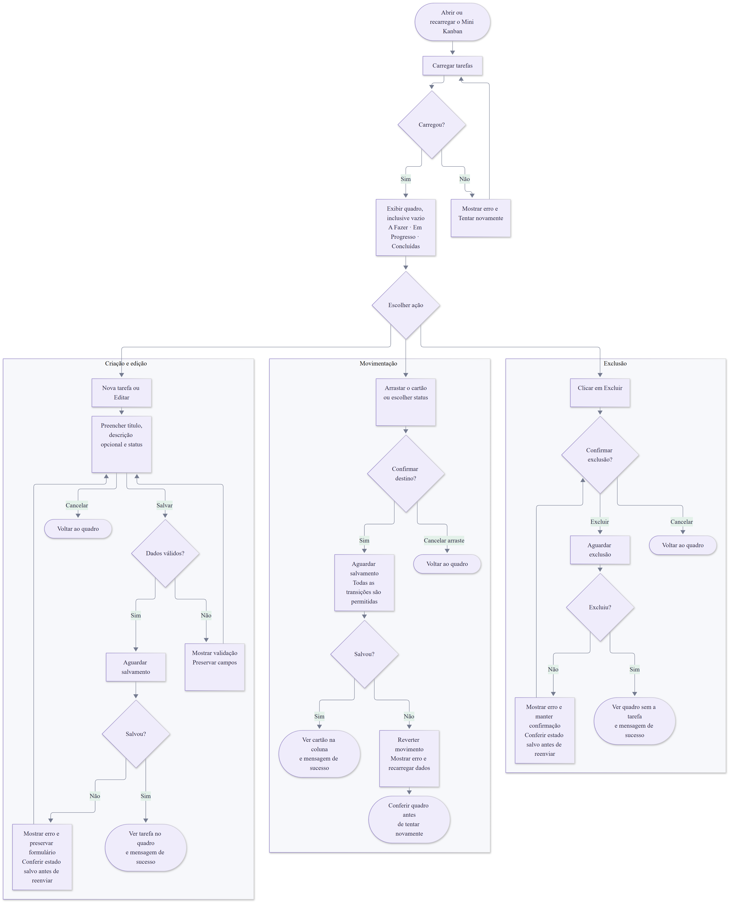

# Veritas · Mini Kanban

Desenvolvi este Mini Kanban para organizar tarefas em **A Fazer**, **Em Progresso** e **Concluídas**, usando **React** no frontend, **Go** na API e **arquivo JSON** para persistência, conforme o [Desafio prático](./Desafio%20pr%C3%A1tico.txt).

**Em revisão:** estou finalizando a revisão do projeto e mantenho o repositório privado até concluir essa etapa. Antes do envio, vou torná-lo público para permitir a avaliação.

Com Git instalado, obtenha o código e escolha uma das formas de execução abaixo:

```sh
git clone https://github.com/CDNtiago/desafio-fullstack-veritas.git
cd desafio-fullstack-veritas
```

## Funcionalidades

- Criar, editar e excluir tarefas com confirmação.
- Mover entre todas as colunas por arraste ou seletor de status.
- Título, descrição opcional e status, validados também no servidor.
- Feedback de carregamento, salvamento, sucesso, falha e quadro vazio.
- Formulário preservado em falhas; movimento otimista com reversão e reconciliação.
- Interface responsiva, teclado, foco visível e anúncios acessíveis.
- Dados preservados ao recarregar a página e reiniciar a API.

## Executar com Docker Compose

Requer Docker Engine/Desktop com Compose v2 ou superior, em modo de containers Linux. Não requer Go ou Node no host. Na raiz:

```sh
docker compose up --build -d --wait
```

Interface: <http://localhost:5173>. API: <http://localhost:8080/tasks>. Disponibilidade: <http://localhost:8080/health>.

```sh
docker compose logs -f
docker compose down
```

`down` preserva as tarefas no volume `tasks-data` (nome físico prefixado pelo projeto Compose). Para **apagar todas as tarefas**, use `docker compose down --volumes` com a aplicação parada.

Se as portas estiverem ocupadas, copie `.env.example` para `.env`, altere `BACKEND_PORT` e `FRONTEND_PORT` e repita o build. Exemplo: `8095` e `5185`. O Compose ajusta CORS e a URL da API no build. Acesse a interface na nova porta.

## Executar nativamente

Versões usadas: **Go 1.27.3**, **Node.js 24.19.0**, **React 19.3.1**, **TypeScript 6.0.3** e **Vite 8.3.4**. Go e Node devem estar no PATH. As dependências npm estão fixadas no lockfile.

Na raiz, abra dois terminais.

**Terminal 1 — API:**

```sh
cd backend
go run .
```

**Terminal 2 — frontend:**

```sh
cd frontend
npm ci
npm run dev
```

Acesse <http://localhost:5173>. O backend usa `backend/data/tasks.json` quando iniciado de dentro de `backend`. Diretório e arquivo são criados na primeira gravação. Encerre com `Ctrl+C`.

Para conferir o build da interface, pare o servidor de desenvolvimento e execute em `frontend`:

```sh
npm run build
npm run preview
```

### Configuração

| Variável | Padrão | Uso |
| --- | --- | --- |
| `HTTP_ADDR` | `127.0.0.1:8080` | Endereço da API nativa |
| `TASKS_FILE` | `data/tasks.json` | Caminho relativo ao diretório do processo |
| `ALLOWED_ORIGINS` | `http://localhost:5173,http://127.0.0.1:5173` | Origens exatas, separadas por vírgulas, sem barra final |
| `VITE_API_URL` | `http://localhost:8080` | URL da API usada no desenvolvimento/build |
| `BACKEND_PORT` / `FRONTEND_PORT` | `8080` / `5173` | Portas do host no Compose |

O Go lê variáveis do processo, **não carrega `.env` automaticamente**. O Vite lê `frontend/.env`; o Compose lê `.env` na raiz. Não há segredos necessários.

Exemplo com portas alternativas no **PowerShell**, dentro de `backend`:

```powershell
$env:HTTP_ADDR = '127.0.0.1:8093'
$env:ALLOWED_ORIGINS = 'http://localhost:5183,http://127.0.0.1:5183'
go run .
```

No segundo terminal, dentro de `frontend`:

```powershell
$env:VITE_API_URL = 'http://127.0.0.1:8093'
npm run dev -- --port 5183
```

Em shells POSIX, use respectivamente `HTTP_ADDR=127.0.0.1:8093 ALLOWED_ORIGINS=http://localhost:5183,http://127.0.0.1:5183 go run .` e `VITE_API_URL=http://127.0.0.1:8093 npm run dev -- --port 5183`.

## API

O enunciado nomeia `/tasks`; adotei o ID no caminho nas operações individuais.

| Método | Rota | Corpo | Sucesso |
| --- | --- | --- | --- |
| GET | `/tasks` | — | `200`, array, incluindo `[]` |
| POST | `/tasks` | `title`; `description` e `status` opcionais | `201`, tarefa criada |
| PUT | `/tasks/{id}` | `title`, `description`, `status` obrigatórios | `200`, tarefa atualizada |
| DELETE | `/tasks/{id}` | — | `204`, sem corpo |
| GET | `/health` | — | `200`, disponibilidade |

Criação e atualização exigem `Content-Type: application/json`. Exemplo:

```json
{
  "title": "Revisar a entrega",
  "description": "Conferir README, testes e User Flow.",
  "status": "todo"
}
```

A resposta também contém `id` (32 caracteres hexadecimais aleatórios), `createdAt` e `updatedAt` (RFC 3339 em UTC). Esses campos são controlados pelo servidor e não são aceitos na entrada.

Título: 1–120 caracteres após trim. Descrição: até 2.000. Status: `todo`, `in_progress` ou `done`. Corpo: até 16 KiB. Texto é contado por pontos de código Unicode. POST sem status usa `todo`; descrição ausente usa string vazia. Campos desconhecidos, tipos incorretos e valores `null` são rejeitados. Títulos iguais são permitidos.

Mover uma tarefa usa PUT, preservando título e descrição. Cartões são ordenados por criação, com desempate pelo ID; não há reordenação manual dentro da coluna.

Formato dos erros:

```json
{
  "error": {
    "code": "validation_error",
    "message": "Dados da tarefa inválidos.",
    "fields": { "title": "Informe um título de 1 a 120 caracteres." }
  }
}
```

`fields` é opcional. Status HTTP: `400` entrada inválida; `403` origem/cabeçalho recusado pelo CORS; `404` recurso inexistente; `405` método indevido; `413` corpo excessivo; `415` mídia incompatível; `500` falha interna. Excluir novamente o mesmo ID retorna `404`.

## Arquitetura e decisões

```text
backend/
  main.go              inicialização e configuração
  handlers.go          HTTP, JSON de entrada, CORS e respostas
  models.go            modelo e validações
  service.go           regras de negócio e interface Repository
  repository.go        implementação JSON e sincronização
frontend/
  src/components/       ícones e modal
  src/tasks/            modelo, cliente HTTP, hook e componentes
  tests/                Playwright com API real e dados isolados
docs/user-flow.png      diagrama obrigatório do fluxo de uso
```

- **Go com biblioteca padrão:** optei por não adicionar framework ou ORM, pois a biblioteca padrão atende ao escopo. O servidor de execução não tem dependências externas.
- **JSON:** escolhi uma alternativa permitida no desafio. Os dados são lidos em memória, e cada alteração só é confirmada após a gravação no arquivo.
- **Responsabilidades:** separei HTTP nos handlers, regras no serviço e arquivos no repositório. A interface pequena permite testar cada responsabilidade.
- **React, TypeScript e Vite:** usei tipagem estrita e um build simples. Para um quadro único, não precisei de roteador ou gerenciador global de estado.
- **dnd-kit:** escolhi a biblioteca para oferecer arraste por ponteiro e teclado, mantendo o seletor de status como alternativa explícita.
- **Identidade visual:** usei o azul-petróleo e o dourado observados no [site de carreiras da Veritas](https://carreiras.veritas.law/), mantendo a área de trabalho clara. Centralizei as cores em variáveis CSS e adaptei tons para contraste.
- **Consistência:** mutações da interface serializadas; respostas antigas descartadas. Erros de movimentação revertem o estado e consultam a API, sem repetir automaticamente mutações.
- **Testes:** simulações restritas a testes de componentes/falhas; o E2E principal usa React, HTTP, Go e JSON reais. Sem MSW.

### Limitações e dados

Quadro local único, sem login. Todos os clientes com acesso à API podem operar tarefas; CORS não autentica. Uma instância por arquivo; a última gravação concluída da mesma tarefa prevalece. A interface recarrega ao recuperar foco; não há colaboração em tempo real.

O arquivo é regravado integralmente, com mutex, temporário, sincronização e substituição sem apagar antes o original. `Rename` não garante atomicidade no Windows; não há garantia transacional contra queda de energia. Arquivos inválidos, inclusive com bytes UTF-8 corrompidos, impedem a inicialização, preservando o conteúdo.

Para reiniciar dados nativos: pare a API, faça backup de `backend/data/tasks.json` e remova ou renomeie apenas esse arquivo. No próximo início o quadro estará vazio. Não edite o JSON enquanto o serviço estiver executando.

### Melhorias futuras

- Adicionar busca e filtros para facilitar quadros maiores.
- Adicionar controle de versão das tarefas para detectar edições concorrentes.
- Oferecer exportação e restauração de backups pela interface.
- Caso o produto evolua para uso compartilhado, avaliar autenticação, autorização por quadro e persistência transacional. Isso exigiria ampliar o escopo; a entrega atual mantém o armazenamento JSON permitido no desafio.

## Testes e qualidade

Em `backend`:

```sh
go test ./...
go vet ./...
go run golang.org/x/vuln/cmd/govulncheck@v1.9.0 ./...
```

No Linux com compilador C, execute também `go test -race ./...`. Os testes usam diretórios temporários e cobrem HTTP, CORS, validação, reinício, corrupção, falhas de escrita e concorrência.

Em `frontend`:

```sh
npm ci
npm run format:check
npm run lint
npm test
npm run build
npm audit --audit-level=high
npx playwright install chromium
npm run test:e2e
```

No Linux, use `npx playwright install --with-deps chromium`. O E2E requer Go no PATH e portas **5174 e 8082** livres. Compila seu próprio binário e usa um diretório temporário do sistema, sem reutilizar serviços existentes nem alterar dados da aplicação. Diretórios temporários residuais podem permanecer após encerramento forçado no Windows.

A CI verifica Go em Windows e Linux, race detector, frontend, E2E, auditorias e containers com reinício do backend.

## User Flow



Incluí a imagem obrigatória do fluxo de uso em `docs/user-flow.png`. Para gerar uma nova captura da interface, inicie uma instância de desenvolvimento vazia e execute `node scripts/capture.mjs` em `frontend`. O script cria cinco exemplos e remove apenas os que criou ao terminar. Use `CAPTURE_URL` e `CAPTURE_API_URL` para portas alternativas.

## Demonstração e entrega

1. Criar e editar uma tarefa.
2. Mover por arraste e seletor, incluindo retorno a A Fazer.
3. Recarregar a página e reiniciar a API para comprovar persistência.
4. Cancelar e depois confirmar a exclusão.
5. Demonstrar entrada inválida rejeitada pela API e explicar HTTP → serviço → JSON.
6. Mostrar testes, User Flow e decisões técnicas.

Pesos oficiais: funcionalidade **40%**, arquitetura **25%**, UI/UX **15%**, documentação **15%**, Git **5%**. O edital exige nota mínima 7 e demonstração de domínio mínimo da solução.

Vou enviar exclusivamente o link do repositório público **desafio-fullstack-veritas** pelo canal indicado pela empresa. Antes do envio, vou conferir o acesso sem login ao código, ao README e à imagem do User Flow. Até concluir a revisão, mantenho o repositório privado. Ainda preciso confirmar o canal e o prazo vigentes: o edital menciona um formulário, mas o endereço não consta nos documentos que recebi.

Também conferi o projeto com o PDF **DESAFIO TÉCNICO - ORIENTAÇÕES**: descrição opcional, título obrigatório, status válido, limitações e melhorias futuras no README. Arraste, JSON, Docker e testes são bônus opcionais nesse documento. Mantive os nomes `main.go`, `handlers.go` e `models.go` apresentados nas orientações e separei serviço e repositório em arquivos próprios para manter as responsabilidades claras.
