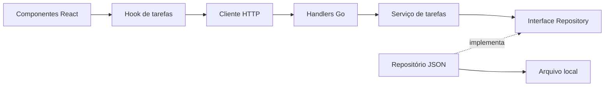

# Arquitetura

O serviço contém validações e geração de identificadores/datas, sem conhecer HTTP ou arquivos. O repositório implementa leitura e mutações serializadas. O transporte traduz erros e valida o formato das requisições. A composição das dependências fica na inicialização.

No frontend, componentes apresentam dados e coletam intenções; o hook coordena requisições e operações pendentes; o cliente HTTP define o contrato. O backend é a fonte de verdade.

Um processo por arquivo JSON. Edições concorrentes da mesma tarefa adotam a última gravação bem-sucedida. Não há usuários, autorização, banco de dados ou sincronização em tempo real.
